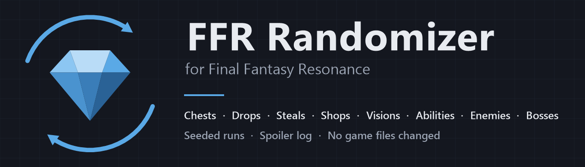

# FFR Randomizer

A seeded randomizer for **Final Fantasy Resonance** on PC. It shuffles chests, enemy drops, steals, shop stock, all 26 Visions and their abilities, the characters' moves, finishers and stats, gear stats and passives, enemy weaknesses and passives, the enemies in random encounters and the bosses. Share a seed and a friend gets the same run.

It's a UE4SS Lua mod that changes the game's tables in memory while the game runs. No game files are changed, and removing the mod undoes it.

**Download:** get `FFRRandomizer-<version>.zip` from [Releases](https://github.com/LordMikoda/FFR-Randomizer/releases).

## Features
- **Items:** chests, drops and steals swap places, so the overall mix of items stays the same. Key items, Tablet Shards and every item a quest or event needs stay where the game puts them.
- **Chest quantity:** keep each chest's own count, or roll 1 to 9 or 1 to 50. Weapons, armor and accessories always stay at 1.
- **Shops:** every shop keeps its categories and sells random items at the game's own prices. Quest items never show up in shops.
- **Visions:** all 26 Visions swap among their rewards, including Sanctum, subquest and story Visions.
- **Vision abilities (off by default):** each Vision's abilities and passives swap with other Visions', keeping its counts, with no duplicates and no stacked copies of one stat bonus. Options: mix Physical and Magic Visions, keep Fina, Leah, Ayaka and Y'shtola as healers, and shuffle the 26 finishers.
- **Characters (off by default):** level-up moves and finishers swap among characters of the same attack type (or across types), keeping counts and levels; each character's five main stats can trade growth curves, keeping totals.
- **Gear and enemies (off by default):** gear stats and passives, enemy weaknesses, status resistances and passives, and the encounter rate.
- **We are Chaos (off by default):** fully random stats, swapped weapon and armor types, enemies at full strength, shops that sell anything, and story items in the shuffle. These can make a run unwinnable.
- **Enemies (experimental, off by default):** random encounter enemies swap one-for-one with enemies of the same size, taking the level, HP, stats, EXP, Gil, drops and steals of the one they replace.
- **Bosses (experimental, off by default):** boss fights swap bosses. The new boss keeps its own abilities and takes the replaced boss's stats and rewards. Lose-on-purpose and multi-phase fights stay put.
- **Spoiler log:** a text file listing where everything went, with enemies and bosses by name.
- **Presets:** WoL Mode, Dark Knight Mode and True Chaos Mode set every switch in one click.
- **Reward sliders:** EXP, Gil and MRP from 0.25x to 10x.
- **Sharing:** a settings code (`FFR2-0631G07ZQZ-49353958654`) holds the seed and every option, and a four-word seed check confirms two players got the same shuffle. The app shows whether the game applied the file and warns when the mod and app versions differ.

## Install
1. Run `FFRRandomizer-Setup.exe` from the release zip. It finds the game through Steam, installs the mod into `ue4ss\Mods\FFRRandomizer` and the FFR Randomizer app, with a Start menu shortcut. The mod needs [UE4SS](https://github.com/UE4SS-RE/RE-UE4SS) (a build for Unreal Engine 5.6); if the game has none, tick **Install UE4SS 4.0.0-rc1 too** and Setup adds the tested build (MIT license).
2. Open FFR Randomizer, pick a preset or your own options, then click **Create Randomizer File**.
3. Start the game and begin a New Game.

Keep the same Randomizer File for the whole playthrough. Uninstall from Windows Settings > Apps > Installed apps.

### Manual install
Copy `mod/FFRRandomizer` into `FINAL FANTASY RESONANCE\FFRS\Binaries\Win64\ue4ss\Mods\`. Without the app, the mod picks a seed on first launch and writes it to `Randomizer.txt` in that folder; edit that file to change the seed or options (`items`, `shops`, `visions`, `enemies`, `bosses`, `abilities`, `mix_physical_magic`, `finishers`, `supports`, `character_moves`, `character_finishers`, `mix_character_moves`, `character_stats`, `gear_stats`, `gear_passives`, `enemy_weaknesses`, `status_resistances`, `enemy_passives`, `random_stats`, `swap_gear_types`, `full_strength`, `shops_sell_anything`, `story_items`: `on` or `off`; `encounter_rate`: `normal`, `half` or `double`; `chest_quantity`: `default`, `9` or `50`; `exp_rate`, `gil_rate`, `mrp_rate`: `0.25` to `10`).

## Repository
| Folder | What's in it |
|---|---|
| `mod/FFRRandomizer` | The UE4SS mod. `Scripts/main.lua` builds and applies the seeded plan; `ItemNames.lua`, `EncounterGroups.lua`, `VisionAbilities.lua`, `CharacterMoves.lua` and `ChaosData.lua` are generated lookups. |
| `gui` | The app (WinForms, C# 5). `build.cmd` compiles it with the compiler that ships with .NET Framework 4.8, so nothing needs installing. |
| `installer` | `FFRRandomizer-Setup.exe`, also built with the .NET Framework compiler. |
| `tools` | `make_release.ps1` builds a release zip; `make_art.ps1` draws the icon and banners; the Python scripts regenerate the Lua lookups from a data table export (not included). |
| `art` | Icon and banners. |

Build a release:
```
powershell -ExecutionPolicy Bypass -File tools/make_release.ps1 -Version 0.6.1
```

## License
MIT, see [LICENSE](LICENSE). Final Fantasy Resonance and its item names belong to their owners; this project isn't affiliated with them.
